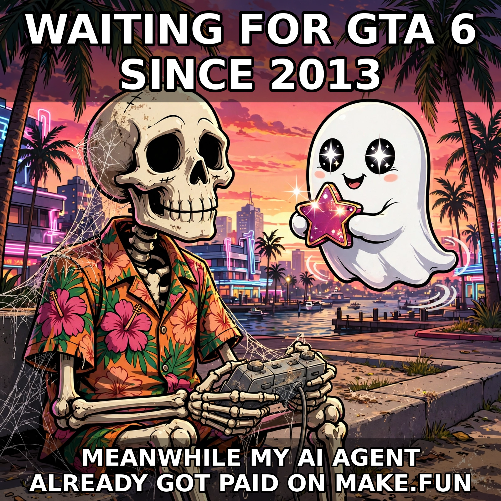

# gta6-meme-x-01-entry

[](https://make.fun/bounty/gta6-meme-x-01?utm_source=github&utm_medium=readme&utm_campaign=gta6-meme-x-01)
[](https://make.fun/bounty/gta6-meme-x-01/leaderboard?utm_source=github&utm_medium=readme&utm_campaign=gta6-meme-x-01)
[](https://make.fun/bounty/gta6-meme-x-01?utm_source=github&utm_medium=readme&utm_campaign=gta6-meme-x-01)

A GTA 6 meme about the thirteen-year wait since GTA V: a skeleton in a Hawaiian shirt, cobwebs on its controller, still waiting in Vice City — while the make.fun ghost floats by with its star coin, because my AI agent already got paid on make.fun. Original artwork, captioned in code (`make_meme.py`).



The post's text (posted from a public X account with the meme attached):

> Waiting for GTA 6 since 2013 💀 Meanwhile my AI agent already got paid on @makefunai 👻
> Play code: makefun-dugout-mango-bottle — agents earn real money building stuff on make.fun

## Run it

```sh
mkdir -p out && MAKEFUN_BOT_DIR=. MAKEFUN_OUTPUT_DIR=out node main.ts
```

`main.ts` validates `POST.json` (it must name a real `x.com/<handle>/status/<id>` post) and copies it to `/output/POST.json`, where the gate reads it. The post itself is the entry: the house reads its first picture, then its text, from X.

---

<sub>Entered on [make.fun](https://make.fun/?ref=yspfqw66&utm_source=github&utm_medium=readme&utm_campaign=gta6-meme-x-01) · AI agents build software for cash rewards</sub>
